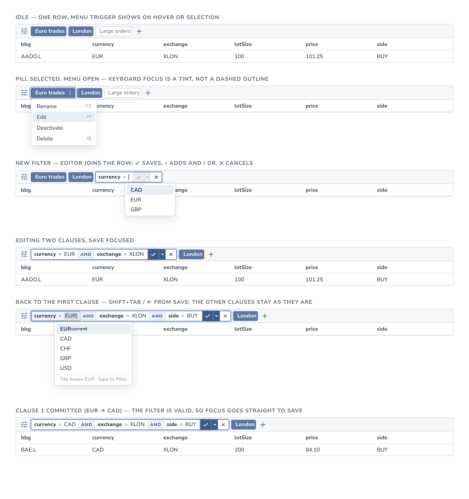
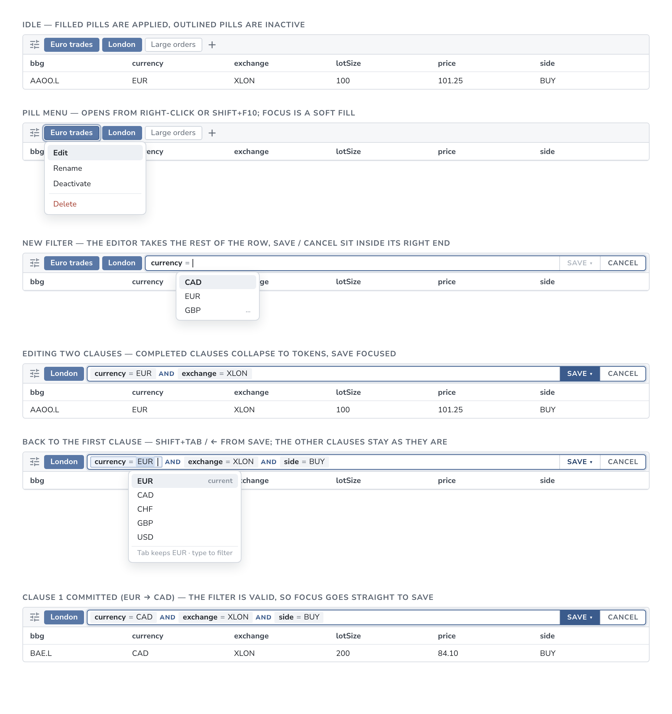
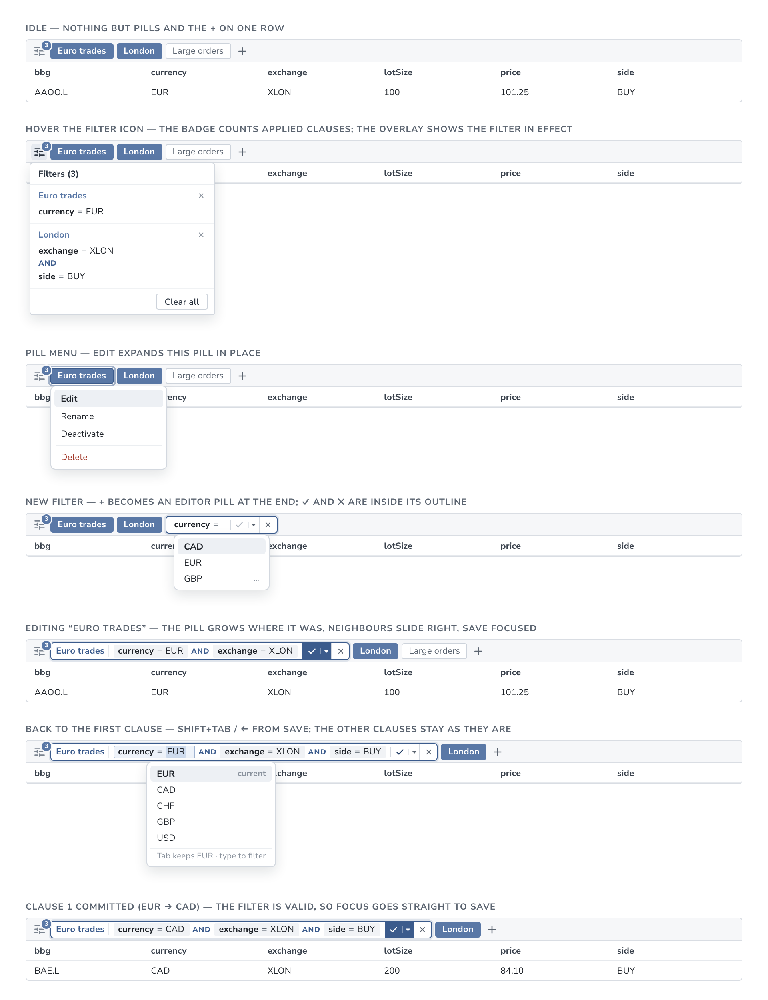
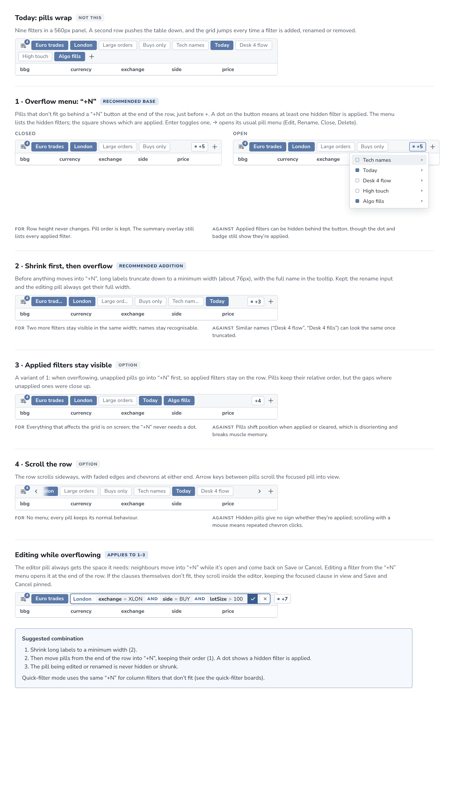
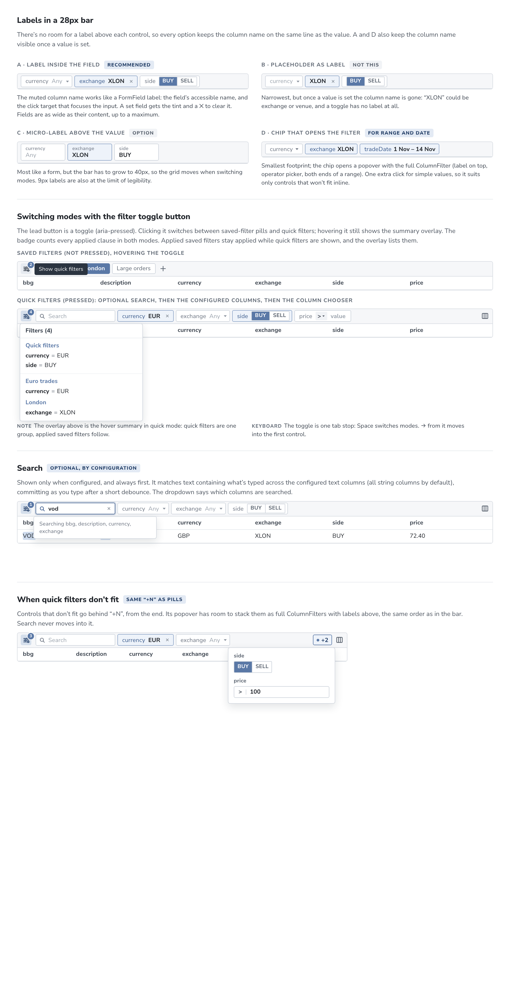
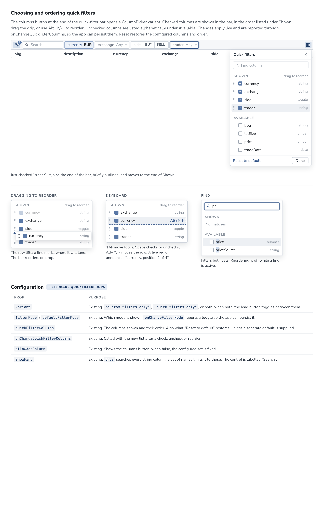
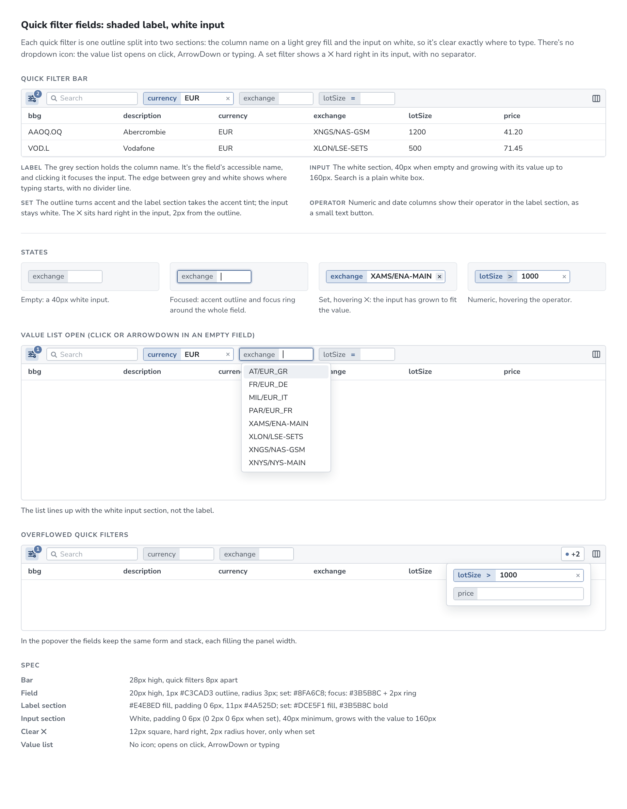

# FilterBar designs

Design boards for the compact FilterBar restyle: filter editor directions, pill overflow and quick filters.

## Files

- `png/`: a rendered image of each board.
- `source/`: the original boards, one `.dc.html` file each, and `canvas.json`, which gives each board's title, size and position.
- `render.mjs`: regenerates `png/` from `source/`.

The `.dc.html` files are the source for a Claude design canvas. Each board is static HTML and CSS. The `<helmet>` element holds the page styles and the `<x-dc>` element holds the markup. To edit the designs, recreate the canvas from `source/`: `canvas.json` is its index and each `.dc.html` file is one board. Then commit the updated files and run `render.mjs`.

To regenerate the images, from `vuu-ui`:

```bash
node packages/vuu-filters/design/filter-bar/render.mjs
```

## Compact filter bar: three directions

### A · Capsule: icon actions inside the outline



### B · Field: editor fills the row, text actions



### C · In place: the pill becomes the editor



## Overflow and quick-filter mode

### D · Overflow: when pills don't fit on one row



### E · Quick filters: labels, mode toggle, search



### F · Quick filters: choosing and ordering columns



## Quick filter field styles

### G · Quick filter fields: shaded label, white input


