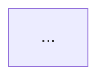
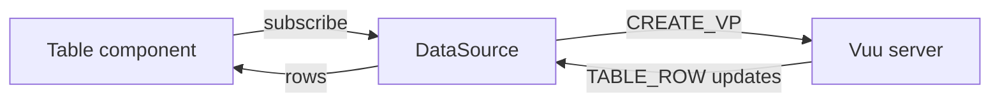

# Diagrams

Showcase documents can include [Mermaid](https://mermaid.js.org) diagrams, authored as fenced code blocks with the `mermaid` language, the same form supported by GitHub and Docusaurus. Diagrams follow the Showcase light/dark theme mode.

````md

````

## Example

The flow of a viewport subscription between the UI and the Vuu server:


